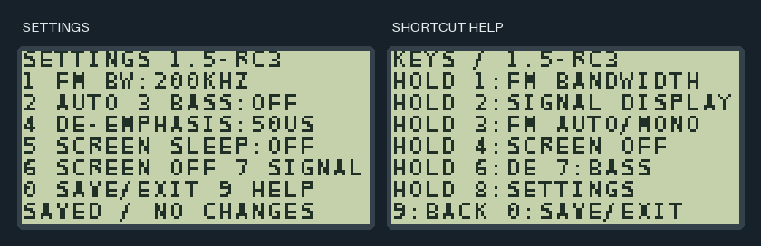
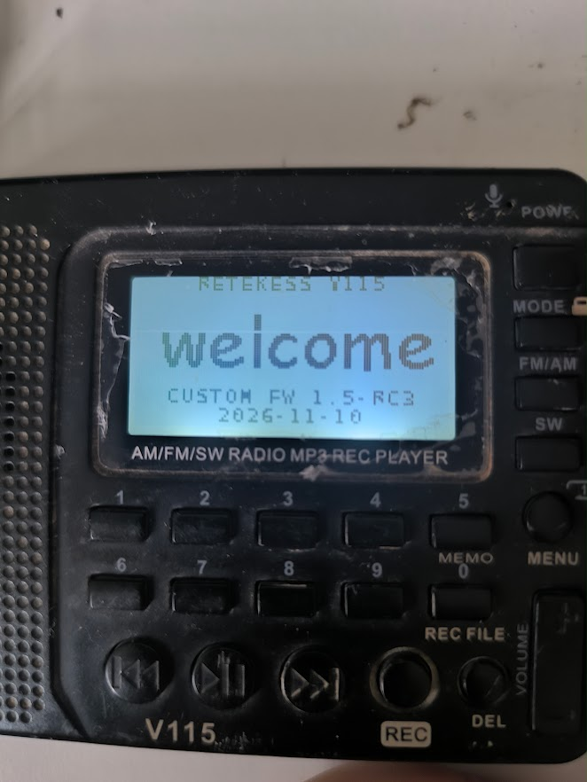
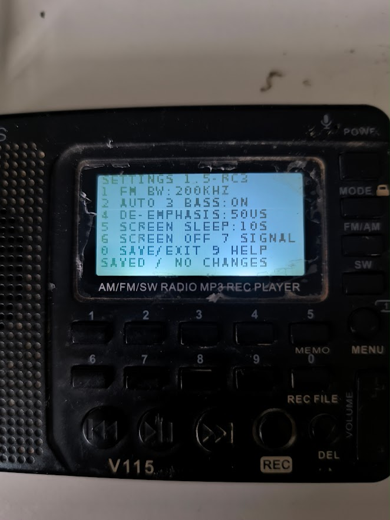

# Retekess V115 Custom Firmware

Expanded tuning, a settings menu, saved FM preferences, and proper screen sleep
for the Retekess V115. This project patches a verified stock v1.4 image and
assembles the added 8051 code directly in Python.

**Current version: 1.5-RC3 · Linux development tools · 2 MiB SPI flash**



## Features

- **Extended tuning:** FM 30–230 MHz and SW-mode AM 150–30,000 kHz. Original
  MW 9/10 kHz bands are retained.
- **FM controls:** 200/150/100/50 kHz bandwidth, automatic stereo or forced
  mono, bass boost, and 50/75 µs de-emphasis.
- **Signal diagnostics:** C/N, estimated RF level, frequency offset, stereo
  status, tuner gain, and tuner supply voltage.
- **Display sleep:** switches off the LCD and backlight while audio continues.
  The first complete key gesture wakes the screen without changing a setting.
- **Settings and help:** an on-radio menu, saved FM preferences, and automatic
  screen sleep after 10, 30, or 60 seconds, or Off.
- **Versioned startup:** firmware version and build date on the welcome screen.

RC3 has passed instruction emulation, LCD rendering from RAM, and verified USB
programming on matching hardware. Cold-boot checks of RC3 preferences and
actual automatic-sleep timing on the installed radio are still pending.

## On the radio

| RC3 startup | Settings menu |
| :---: | :---: |
|  |  |

## Controls

Use these shortcuts during idle radio playback with the keypad unlocked.

| Hold | Action |
| --- | --- |
| **1** | Cycle FM bandwidth: 200 → 150 → 100 → 50 kHz |
| **2** | Open or close signal diagnostics |
| **3** | Toggle FM automatic stereo / forced mono |
| **4** | Switch off the screen and backlight |
| **6** | Toggle FM 50/75 µs de-emphasis |
| **7** | Toggle FM bass boost |
| **8** | Open settings |

Stock **hold 5** retains its numeric-entry behavior. Normal short-digit entry
is retained outside the custom screens.

Inside **settings**, use:

| Key | Action |
| --- | --- |
| **1 / 2 / 3 / 4** | FM bandwidth / mono / bass / de-emphasis |
| **5** | Screen timeout: Off → 10 → 30 → 60 seconds |
| **6** | Save, exit, and switch off the screen |
| **7** | Save, exit, and open diagnostics |
| **9** | Show or hide shortcut help |
| **0**, or **hold 8** | Save and exit |

FM settings apply only in FM. Menu changes save on exit; shortcut changes save
after about three seconds of idle playback. Wait for that save before removing
power or changing tasks. Automatic screen sleep defaults to **Off**, pauses
in settings and during scanning, and resets its countdown on key activity.

Inside **FM diagnostics**, short keys are **1** bandwidth, **2** mono, **3**
exit, **4** screen off, **5** bass, and **6** de-emphasis. In **AM diagnostics**,
use **3** to exit and **4** for screen off.

## Build

Requirements: Python 3.10+, Pillow, and `make`. Full instruction verification
also needs **uCsim `s51`**; install the `sdcc-ucsim` package on Debian/Ubuntu or
set `S51` to the executable path. USB tools use the system `libusb-1.0` library.

```sh
python3 -m venv .venv
. .venv/bin/activate
python3 -m pip install -r requirements.txt
python3 fetch_references.py --firmware
make build
make verify
```

`fetch_references.py` downloads the public stock v1.4 image and matching vendor
loader helper, verifies their SHA-256 hashes, and decodes the helper locally.
These downloaded files are ignored by Git. To use an existing stock backup,
run the fetcher without `--firmware` and pass `SOURCE=/path/to/stock.bin` to
`make build` and `make verify`. The executable and CRC-table prefix must match
the researched stock v1.4 layout; individual saved settings may differ.

The output is `build/v115-full-features-rc3.bin`, a complete scrambled SPI
image, with a manifest, validation reports, decoded analysis image, and boot
preview alongside it. **Program the `.bin` image, not `.decoded.bin`.**
Builds are deterministic. Existing image outputs are not overwritten; use
`make clean` before rebuilding, or select a new output with `IMAGE=...`.

`make smoke` runs a quick display check. `make verify` runs the full suite:

- 6,922 native instruction cases and 512 stock LCD guard cases.
- 912 cold-start preference cases, including invalid saved records.
- 10,226 tuning-grid frequencies, 90 boundaries, and 10 UI getters.
- Rebuild, scrambling, header/section CRCs, all 61 block CRCs, and resource
  preservation checks.
- A NOR-flash model covering update guards, interrupted writes, oversized
  erase detection, and restoration of the original image.

## Backup and flash

The USB tools target **SPI080-Loader 1.00** (`1908:4870`). The writer supports
the tested **Zbit `5e4015`** flash profile: 2 MiB capacity, 4 KiB sectors, and
256-byte pages. Other loaders and flash chips are rejected.

1. Unplug USB and remove the battery. Hold **1** while reconnecting a USB data
   cable. If USB alone does not power the radio, reinsert the battery while
   still holding **1**. Release it once the loader appears.
2. Give your user access to the matching USB device. Find its current bus and
   device numbers with `lsusb -d 1908:4870`.
3. Make a fresh double-read backup:

   ```sh
   mkdir -p local
   python3 usb_dump.py --raw-usb --output local/radio.bin
   ```

4. Prepare and inspect an offline update plan:

   ```sh
   python3 flash_update.py --baseline local/radio.bin --source stock.bin \
     --image build/v115-full-features-rc3.bin --session local/plan
   ```

5. To program, use a new session directory and add `--write`:

   ```sh
   python3 flash_update.py --baseline local/radio.bin --source stock.bin \
     --image build/v115-full-features-rc3.bin --session local/flash --write
   ```

The writer accepts supported stock firmware or this exact release. Older custom
releases require a separately reviewed migration. It requires matching backup
reads and image-bound validation, preserves the first **8 KiB**, retains current
settings and station lists, and changes only application code, its CRC table,
and the existing welcome bitmap. It performs an erase/program/restore trial,
verifies each changed sector, then checks two complete readbacks. Session
folders retain the original image, target, plan, and recovery journal.

Keep your verified original backup outside the checkout and have SPI recovery
available. After verification finishes, disconnect USB and restart normally
without holding **1**. For an RC3 acceptance check, open settings, select **10S**,
save with **0**, test sleep/wake, then restart and check that the preference remains.

## Implementation

| Area | Implementation |
| --- | --- |
| Image format | Per-block scrambling, section CRCs, and a 61-entry block CRC table |
| Native code | Common glue plus 2 KiB banks 0x31–0x34 for menu, preferences, control, and diagnostics |
| Preferences | Eight bytes at group-0 offsets 0xE0–0xE7, using the stock parameter-record writer |
| Display | ST7565-compatible 128×64 LCD; SPI/DMA updates are suppressed while asleep |
| Protection | CRC balancing in unused application padding keeps boot/header sectors unchanged |

The current additions use 6,102 bytes of code, font, and strings. Fourteen
wholly empty 2 KiB application banks remain, plus padding in occupied banks.

The extended ranges are software tuning limits; reception, antenna paths, and
RF performance across them are not guaranteed. FM still steps by 100 kHz and
SW-mode AM by 5 kHz. There is no narrowband-FM demodulator; 50 kHz is the
smallest available FM filter. RF level is an estimate, not a calibrated meter.
Screen sleep leaves the CPU and radio running. The earlier quiet-clock experiment
was removed because it did not improve noise in normal operation.

All project documentation is in this README. Firmware dumps, downloaded SDKs,
flash sessions, captures, old builds, and device-specific records are excluded
from version control. `extract_images.py` can inspect image resources in a
local firmware file without adding them to the repository.

## References

- [IliyaZak/Retekess-v115-firmware](https://github.com/IliyaZak/Retekess-v115-firmware)
  — public stock firmware reference.
- [Edragon/buildwin](https://github.com/Edragon/buildwin)
  — AX2227 SDK and original MPTool loader helper.
- [AKC695X](https://github.com/pu2clr/AKC695X)
  — related tuner documentation and register research.

Stock firmware and vendor tools are external inputs and are not bundled here.
