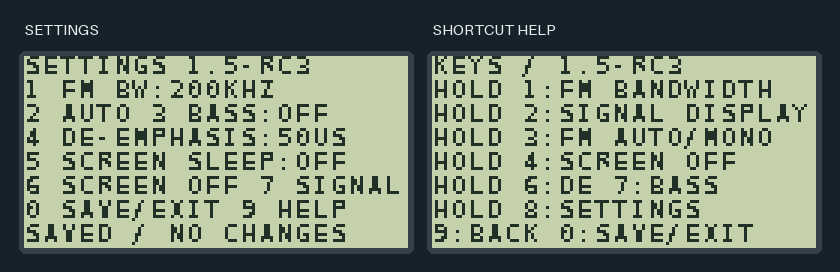
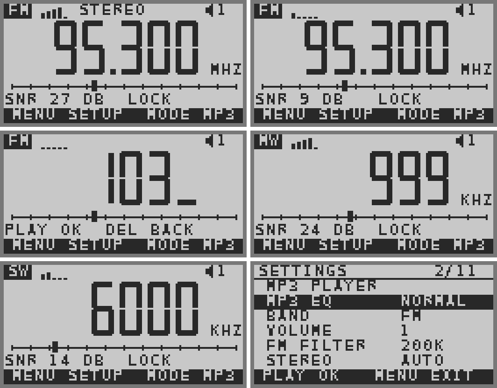
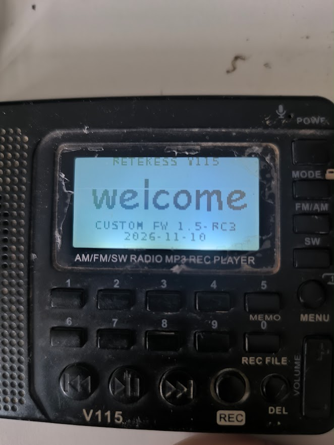
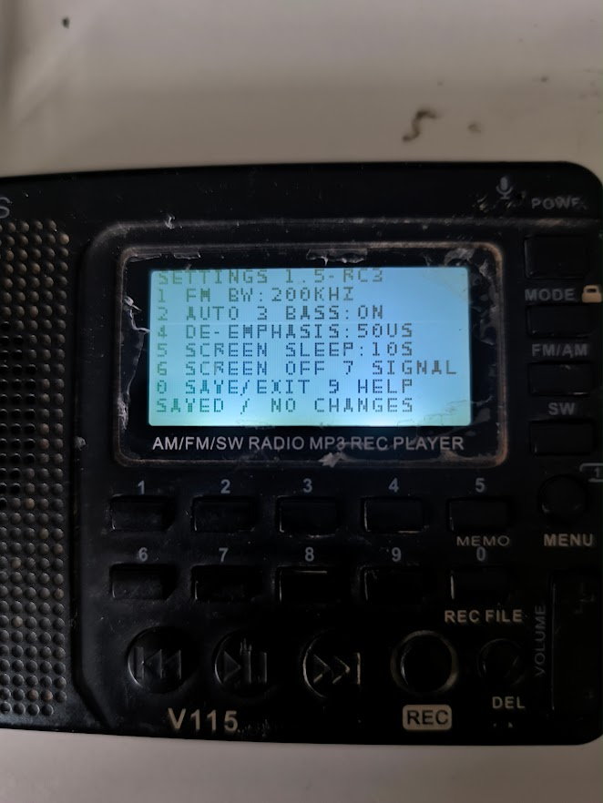

# Retekess V115 Custom Firmware

Expanded tuning, signal history, configurable scanning, saved preferences, and
screen sleep for the Retekess V115. This project patches a verified stock v1.4 image and
assembles the added 8051 code directly in Python.

**Patched release: 1.5-RC6 · Source-built radio: OPEN-0.3.0 (experimental; installed)**

Linux development tools · 2 MiB SPI flash. The two images have separate build
and installation commands; OPEN is a radio application with fewer features.



## Features

- **Extended tuning:** FM 30–230 MHz and SW-mode AM 150–30,000 kHz. Original
  MW 9/10 kHz bands are retained.
- **FM controls:** 200/150/100/50 kHz bandwidth, automatic stereo or forced
  mono, bass boost, and 50/75 µs de-emphasis.
- **Clearer interface:** a large frequency readout, a relative C/N bar, and
  separate FM/AM settings pages.
- **Signal graph:** 32 one-second C/N samples, peak hold, and a fixed 0–60 dB
  scale. History resets on frequency/band changes and pauses in menus, scanning,
  and screen sleep.
- **Preview scanning:** bounded ranges, C/N thresholds, station dwell, direction,
  pause/resume, and skip. It does not replace the saved station list.
- **Signal diagnostics:** C/N, estimated RF level, frequency offset, stereo
  status, tuner gain, and tuner supply voltage.
- **Display sleep:** switches off the LCD and backlight while audio continues.
  The first complete key gesture wakes the screen without changing a setting.
- **Settings and help:** an on-radio menu, saved FM preferences, and automatic
  screen sleep after 10, 30, or 60 seconds, or Off.
- **Versioned startup:** firmware version and build date on the welcome screen.

RC6 fixes hidden native frequency-entry and volume dialogs. Custom LCD ownership
is released before forwarding keys, and native numeric/preset prompts finish
before the custom view resumes. Screen sleep pauses during these prompts.
RC5's single-register tuner-read fix is retained. RC6 passed the full release
suite and was flashed with two matching full-image readbacks, preserving the boot
area, settings, and station lists. Normal-boot frequency-entry/volume acceptance
is pending. Instruction tests use instrumented board services.

## Autonomous source-built radio

**OPEN-0.3.0** adds a graphical radio screen, a settings menu and the stock MP3
player to the OPEN-0.2.6 radio described below. It was installed on 2026-11-24
with two matching full-image readbacks, keeping the boot prefix and saved
settings. On the radio, MENU and MODE both work. The previews below are the
firmware's own LCD output from the instruction simulator: FM stereo, a weak FM
station, frequency entry, MW, SW and the settings menu.



- **Screen:** a status bar (band, five signal bars at 6 dB C/N steps, STEREO
  from AKC6955 register 23 bit 7 or forced MONO, speaker and volume), the
  frequency in 12x32 seven-segment digits, a tuning dial (FM 87.5–108 MHz, MW
  and SW over their tuning range), an SNR/LOCK/BASS or message line, and an
  inverted key-hint bar. The pixel loops (seven-segment glyphs, bars, dial) are
  8051 assembly in `app.c`; SDCC's large-model C for them did not fit the 6 KiB
  overlay. The screen deliberately stays in the overlay: the stock trampoline
  reloads the caller's bank on every return, so drawing from a bank would load
  2 KiB of flash twice per redraw.

- **Boot:** the stock task loop now runs unchanged, except that its boot-time
  mode choice (bank 11, `0x1ACE`) always selects the radio task. The 0.2 startup
  shim and dispatcher patch are removed; the stock radio task loads the OPEN
  overlay and calls it in place of its own.
- **MENU** opens **SETTINGS**: MP3 PLAYER, MP3 EQ, BAND, VOLUME, FM FILTER
  (200/150/100/50 kHz), STEREO (auto/mono), BASS BOOST, DE-EMPHASIS (50/75 µs),
  SCREEN OFF, STANDBY, POWER OFF. Up/down select (with repeat), digits 1–9 jump
  to items 1–9 and 0 to the tenth (POWER OFF is reached by scrolling), Play
  toggles or runs an item, Vol+/Vol− change its value, MENU exits. FM options are
  written to AKC6955 register 7 immediately.
- **MP3 EQ** selects the stock player's preset: NORMAL, POP, ROCK, JAZZ,
  CLASSIC, COUNTRY, BASS. The stock EQ is the DAC's hardware BASS/EQ filter
  (DAC registers 12–15): `music_eq` (bank 15, `0x1CFF`) loads 96 coefficient bytes
  per preset from the mask-ROM table at `0xB988`, or 108 bytes at `0xB76C` for
  BASS. The preset is XDATA `0x3B6A`, saved as setting `0x0D`. OPEN reads it on
  every radio entry, so a change made in the player's own menu shows up. When
  entering the player, OPEN passes the menu choice to the player's `eq_set`
  (bank 9, `0x1A54`), which saves it, and the player applies it at each playback
  start. The filter only processes decoded playback. Stock plays FM with the DAC
  disabled, over the analogue AUX path, so the EQ cannot change radio audio. For
  the radio, the tuner's own BASS BOOST and DE-EMPHASIS are the tone controls.
- **MODE** (or MENU → MP3 PLAYER) restores the board registers OPEN changed and
  enters the stock music task (SD or USB, MP3/WMA/WAV) using the same calls as
  the stock MODE handler: device test `0x2111`, select `0C:1FD1` (USB preferred),
  media check `0x119C`, then `00:1DC9`/`04:1E81`. Without media the radio stays
  and shows `NO SD CARD OR USB`. Inside the player, keys behave as stock; when the
  stock firmware returns to the radio task, OPEN resumes its band, per-band
  frequencies, volume, mute and FM options from RAM.
- **POWER OFF** hands task `0x13` to the stock power-off path. POWER still
  toggles standby.
- **Layout:** the menu runs from empty stock bank `0x2C`, while context save,
  restore, resume and the music handoff run from bank `0x2D`, both through the
  stock banked-call trampoline (`0x0133`/`0x0100`). The zero padding of the
  RAM-resident common code holds the menu and system bank statics (`0x16F0`,
  `0x1700`), the overlay's statics and locals (`0x1730`–`0x17AF`) and the radio
  state (`0x17B0`). The overlay may use internal RAM only up to `0x09`; the banks
  use `0x0A`–`0x0F`, and the build rejects anything more. The stock PC/USB mass-storage overlay (task 4) used
  to start at `0x1E800`, where the 6 KiB radio overlay overlaps it; it is copied
  unchanged to banks `0x2E`–`0x30` and its single loader repointed.

Confirmed on hardware (2026-11-24): MENU and MODE work. Menu keys and drawing
load bank `0x2C`, and MODE loads bank `0x2D` and the stock player's banks,
from SPI flash while the radio's own peripheral setup is active. Normal
listening loads no banks. The stock loader CRC-checks each block and resets
through the watchdog on failure, so a fault here would show up as a reboot,
never as a write.

**OPEN-0.2.6** is the autonomous source-built radio, developed from the OPEN-0.1
RAM prototype.
The image retains the established bootstrap and initial clock/DAC setup, then
starts the C radio regardless of the previous task or inserted memory card.
The loader copies all three 2 KiB blocks of the radio program. The startup
POWER gesture is consumed before normal key handling begins.
Its own Timer1 polls the keypad and runs the radio at 20 ms intervals; a
512 ms watchdog recovers a stalled loop. No host tick calls are needed after
normal startup. The radio program occupies about **5.7 KiB** of the existing
6 KiB overlay. The timer follows the existing clock divider so audio keeps
its startup clock configuration; the normal-boot build also retains the
board’s established DAC route. OPEN-0.2.6 uses the stock 0–32 volume curve and the native DAC gain encoding
at `0x7893`. The codec control register `0x7890` keeps its power/bias bits.
Level 0 and Play mute switch off the amplifier and mute the tuner; retuning
and standby retain the chosen level. The stock tuner output pre-gain is retained. The amplifier stays off
during startup and retuning, and enables after the requested channel settles
when volume is nonzero and playback is unmuted. Volume changes between
nonzero levels write only DAC gain: they leave amplifier enable and tuner mute
untouched. The tuner input level stays fixed at its stock `0x8C` setting.

**POWER** enters standby: tuner off, amplifier muted, display and backlight off.
Press **POWER** again to resume the same frequency, band, volume, and mute
setting. The CPU keeps polling in standby; this is not deep power-off.
In OPEN-0.2.6, **MENU** cancels entry or sleeps only the display, with any key waking it
(in 0.3.0 it opens the settings menu; SCREEN OFF there sleeps the display).
Cold startup currently selects FM 95.300 MHz at volume 1. Settings survive
standby in RAM, but OPEN does not yet save them across battery removal.

The source-built radio does not include RC6 scanning, graphs, presets,
recording, or USB media playback. Existing saved settings and station lists
are retained in flash for restoring RC6. All other keys follow the prototype
table below, except that POWER controls standby in OPEN-0.2.6. POWER is a
separate GPIO input; MENU is on the second ADC ladder. In OPEN-0.2.6, REC and
MODE have no action; in 0.3.0, MODE enters the stock MP3 player and REC is ignored. DEL uses the stock ladder code and passes simulated editing
tests, but physical DEL presses have not registered on the test radio.

Build and qualify a candidate with SDCC and uCsim installed:

```sh
make radio-image
make radio-autonomous-verify
```

For a live timer test, reconnect in loader mode and keep USB connected:

```sh
make radio-timer-run
```

This uses the smaller, verified loader RAM allocation and executes 256 native
timer ticks per USB call, about 5.12 seconds. The host reads state between
batches and mutes the speaker when the test ends, as key polling stops then.
Directly loading the full radio overlay while USB is active stalls
this loader during key refresh, so that memory is reserved for normal boot.

After a fresh matching double-read backup, audit and prepare the update:

```sh
make radio-image-verify BASELINE=local/radio.bin
python3 flash_radio.py --baseline local/radio.bin \
  --image build/v115-open-0.3.0.bin --session local/open-plan
```

To install, use a new session directory and add `--write`. The writer accepts
verified stock, RC6, reviewed OPEN-0.2 through 0.2.6, or this exact OPEN
image. Updating from OPEN-0.2.6 rewrites 12 sectors. It uses the existing sector writer, erase/program/restore trial,
rollback journal, and two complete installed-image readbacks. The first 8 KiB
and current settings are protected.
Boot-entry, 16 timer configurations, 188 application cases (88 for the menu,
EQ, music handoff, resume and the graphical screen, every frame compared
pixel-for-pixel with an independent Python model), four amplifier GPIO cases, 140 analogue-gain register
cases, invalid-image guards, interrupted writes, oversized erases, and
restoration to RC6 are checked before writing. For 0.3.0 the audit also runs the
patched boot selection (7 saved modes), the radio's return path to the stock
task, the image's own system bank against the real drivers (register restore and
6 handoff cases), and the USB-overlay relocation.

After installation, disconnect USB and restart normally without holding 1.
Check the OPEN-0.2.6 screen, direct frequency entry, standby/wake, and audio.
OPEN-0.2.2 has confirmed battery startup, frequency entry, headphone audio,
and physical POWER standby/wake. A RAM comparison confirmed speaker station
audio with the amplifier enable high. OPEN-0.2.3 retained that fix, but its
volume keys only updated the tuner register and did not change speaker loudness.
OPEN-0.2.4 changed codec control bits as if they were gain, which changed
loudness but introduced buzz/whine. It is superseded by OPEN-0.2.5, which
uses the stock gain register and starts at volume 1.

OPEN-0.2.5 had clean upward changes but briefly muted on clicks; downward
changes could leave hiss/buzz. OPEN-0.2.6 removes amplifier cuts on nonzero
volume changes and stops rewriting the tuner input level with the DAC level.
The volume hardware check now sweeps all 33 gains up, down, and up again with
audio muted, while checking the fixed tuner input level. It also checks
zero-volume tuner mute, retuning, and standby/wake retention. Native timer
batches and the full image/recovery model qualify each image before
installation. Normal-boot listening acceptance remains necessary; register
readback alone does not establish clean audio. OPEN-0.3.0 was installed with
two matching full-image readbacks, preserving the boot prefix and saved
settings.

Qualify the volume driver and timer before auditing an installation image:

```sh
make radio-timer-build
python3 preview_radio_timer.py --start-muted --batches 2
python3 verify_radio_volume_hardware.py
```

The flash writer requires matching timer and volume hardware evidence. The
volume check exercises the compiled application's key handling and reads back
all 33 stock DAC gain settings in 97 up/down/up samples, plus the fixed tuner
input level; it does not apply a host-side gain override.
The optional listening comparison remains available:

```sh
make radio-volume-run
```

This runs [`preview_radio_volume.py`](preview_radio_volume.py) in the established
loader RAM allocation. It starts **muted at VOL 1**; press **Play** to listen,
and **POWER** to stop. It mutes after 60 seconds without key input and ends
after fifteen minutes. Exit switches off the display, speaker, tuner, and DAC.
Each gain change checks the DAC gain and codec control readback; level zero,
mute, tuning, standby, and application errors keep the speaker disabled.
The local report is `build/radio-volume-preview.json`. This test does not
write flash. Its tick rate is paced by USB, so controls are slower than normal
boot. It does not qualify volume behavior in normal boot or replace the
native-timer hardware test required by the flash writer.

To restore RC6, first make a new matching double-read backup of the installed
OPEN image, build RC6 with `make build`, then use:

```sh
python3 flash_radio.py --restore-rc6 --baseline local/open-installed.bin \
  --image build/v115-full-features-rc6.bin --session local/restore-rc6 --write
```

The loader entry procedure is unchanged: hold **1** while applying USB power,
as described under **Backup and flash** below.

## Source-built RAM prototype

**OPEN-0.1** is the first step toward a replacement radio application. The C
sources in [`firmware/`](firmware/) implement the interface, frequency editor,
key filtering, and AKC6955, LCD, ADC, and audio drivers. They call no stock
application functions. [`radio_audio.py`](radio_audio.py) assembles bounded
8051 startup programs for DAC calibration before the C application is uploaded.
The prototype uses the existing USB loader and its CPU
initialization; a connected computer paces bounded application ticks. It is
not yet an autonomous boot image.

The RAM executable is about **5.4 KiB**, with 73 bytes of application state,
a 128-byte LCD page buffer, and compiler scratch space. Its upload window is
checked against the loader's memory allocation. Every uploaded block is read
back, and each call preserves the loader's registers and interrupt state.
`run_radio.py` exposes RAM upload and execution only; it does not program SPI
flash. Restarting the radio returns to the installed firmware.

Install [SDCC](https://sdcc.sourceforge.net/) (tested with 4.2.0) and uCsim `s51`,
then build and verify with:

```sh
make radio-build
make radio-verify
```

Set `SDCC`, `SDLD`, or `S51` to executable paths when they are not on `PATH`.
With the radio connected in loader mode and USB access configured as described
below, run:

```sh
python3 run_radio.py --self-test --seconds 120
```

The self-test injects labeled synthetic key events and checks actual tuner
channel readback through FM entry, 25 kHz steps, MW, SW, and band switching.
During the following interactive period, physical keys are read and handled
on the radio. Keep USB connected. The program normally mutes audio on exit;
`--leave-audio` keeps the last tuner state, while controls stop when the host
loop ends. State and test reports are written under ignored `build/`.

| Prototype key | Action |
| --- | --- |
| **0–9**, then **Play/Pause** | Enter frequency: `953` = FM 95.300 MHz; AM uses kHz |
| **Delete** | Remove an entered digit |
| **FM/AM** / **SW** | Switch FM/MW / select SW-mode AM |
| **Previous / Next** | Tune by 25 kHz FM, 9 kHz MW, or 5 kHz SW |
| **Volume − / +** | Adjust volume; holding repeats |
| **Play/Pause** outside entry | Mute/unmute |
| **Menu** | Cancel entry, or switch off the LCD and backlight |
| **Any key** while asleep | Wake the screen; release before the next action |
| **Power** | Exit the RAM test |

Tuning stays muted until the returned channel matches the requested channel;
stale completion flags are rejected and a timeout remains muted. The tuner
spacing register is set to 25 kHz: live measurements with the original
100 kHz setting rounded fine manual tunes to the coarser grid.

Instruction tests execute the compiled application with simulated board
services, checking exact screen pixels, frequency boundaries and overflow,
debouncing, mute/sleep, stale status, timeouts, and loader context preservation.
There are 92 application cases, three cases executing the real GPIO
initialization, two POWER GPIO cases, four amplifier GPIO cases, 140 analogue-gain cases, and a DAC
startup context/timeout check. The GPIO tests cover clearing loader-enabled
key pull-ups while preserving other pins; the LCD test
checks that an absent SPI completion flag returns an error within its limit.
Live USB tests have verified FM/MW/SW channel readback. The display, physical
frequency entry, controls, and headphone station audio have been confirmed on
the radio. Speaker station audio was confirmed by a live GPIO comparison.
Presets, scanning, persistent settings, recording, USB playback, and autonomous
startup are outside this prototype; the OPEN-0.2.6 image above adds autonomous
startup.
The RC6 features and controls below apply to the separately installed patched
firmware.

## On the radio

| RC3 startup | Settings menu |
| :---: | :---: |
|  |  |

## Controls

Use these shortcuts during idle radio playback with the keypad unlocked.

| Hold | Action |
| --- | --- |
| **1** | Cycle FM bandwidth: 200 → 150 → 100 → 50 kHz |
| **2** | Open or close signal diagnostics |
| **3** | Toggle FM automatic stereo / forced mono |
| **4** | Switch off the screen and backlight |
| **6** | Toggle FM 50/75 µs de-emphasis |
| **7** | Toggle FM bass boost |
| **8** | Open settings |

Type digits from the main radio screen to open the original frequency editor:
**9 → 5 → 3 → Play/Pause** tunes FM 95.3 MHz. The custom screen resumes when
the editor closes. **Hold 5 / MEMO** opens station storage, rather than frequency
entry, as described in the [radio manual](https://v3.retekess.com/Assets/resource/Radio/V115-EN%2CDE%2CFR%2CES%2CIT.pdf).
Exit diagnostics or settings before direct frequency entry.

Inside **settings**, use:

| Key | Action |
| --- | --- |
| **1 / 2 / 3 / 4** | FM bandwidth / mono / bass / de-emphasis |
| **5** | Screen timeout: Off → 10 → 30 → 60 seconds |
| **6** | Save, exit, and switch off the screen |
| **7** | Save, exit, and open diagnostics |
| **8** | Open preview-scan options |
| **9** | Show or hide shortcut help |
| **0**, or **hold 8** | Save and exit |

FM settings apply only in FM. Menu changes save on exit; shortcut changes save
after about three seconds of idle playback. Wait for that save before removing
power or changing tasks. A `*` in the menu means unsaved changes; `!`
means a save/readback failed and will be retried. RC3 preferences load without
losing FM or screen-timeout choices; scan settings are added on the next save.
Automatic screen sleep defaults to **Off**, pauses
in settings and during scanning, and resets its countdown on key activity.

Inside **FM diagnostics**, short keys are **1** bandwidth, **2** mono, **3**
exit, **4** screen off, **5** bass, and **6** de-emphasis. In **AM diagnostics**,
use **3** to exit and **4** for screen off. In either meter, **7** switches
between values and the signal graph. In the graph, **0** clears history.

## Preview scanning

Open **hold 8 → 8**. Tune to the desired area before opening the scanner.

| Key | Action |
| --- | --- |
| **1** | Range: Broadcast → Near → Wide → Full |
| **2** | Minimum C/N: 4 → 8 → 12 → 16 dB |
| **3** | Station pause: 2 → 5 → 10 seconds |
| **4** | Direction: up / down |
| **5** | Run, pause, or resume |
| **6** | Skip to the next channel |
| **7** | Restart from the selected range boundary |
| **8** | Stop and return to settings |
| **0** | Stop and return to the radio screen |

Broadcast uses FM 87–108 MHz, the original MW band, or SW 4.75–21.85 MHz.
Near spans ±1 MHz in FM or ±100 kHz in AM; Wide spans ±5 MHz or ±500 kHz.
Full uses the expanded band limits. All ranges are clamped to the band and
aligned to its existing tuning step; the actual boundaries appear on screen.

Scanning starts at the current channel when it is inside the range and stops
at the far boundary. A station must complete tuning, report lock, and meet the
C/N threshold before the dwell pause. A tuning timeout advances the scan.
**Hold 4** pauses scanning and sleeps the LCD; after waking, use **5** to resume.
Other ordinary radio controls leave preview scanning before normal handling.
Scan options save when leaving the scanner/menu. The original scan controls
retain their stock behavior.

## Build

Requirements: Python 3.10+, Pillow, and `make`. Full instruction verification
also needs **uCsim `s51`**; install the `sdcc-ucsim` package on Debian/Ubuntu or
set `S51` to the executable path. USB tools use the system `libusb-1.0` library.

```sh
python3 -m venv .venv
. .venv/bin/activate
python3 -m pip install -r requirements.txt
python3 fetch_references.py --firmware
make build
make verify
```

`fetch_references.py` downloads the public stock v1.4 image and matching vendor
loader helper, verifies their SHA-256 hashes, and decodes the helper locally.
These downloaded files are ignored by Git. To use an existing stock backup,
run the fetcher without `--firmware` and pass `SOURCE=/path/to/stock.bin` to
`make build` and `make verify`. The executable and CRC-table prefix must match
the researched stock v1.4 layout; individual saved settings may differ.

The output is `build/v115-full-features-rc6.bin`, a complete scrambled SPI
image, with a manifest, validation reports, decoded analysis image, and boot
preview alongside it. **Program the `.bin` image, not `.decoded.bin`.**
Builds are deterministic. Existing image outputs are not overwritten; use
`make clean` before rebuilding, or select a new output with `IMAGE=...`.

`make smoke` runs a quick display check. `make verify` runs the full suite:

- 8,678 native instruction cases and 2,048 stock LCD guard/ownership cases.
- 1,488 cold-start preference cases, including RC3 migration and invalid records.
- 10 signal-history sequences, 28 graph pixel cases, and 320 home/menu pixel cases.
- 471 scanner state-machine cases and 80 scanner pixel cases.
- 10,226 tuning-grid frequencies, 90 boundaries, and 10 UI getters.
- Rebuild, scrambling, header/section CRCs, all 61 block CRCs, and resource
  preservation checks.
- A NOR-flash model covering update guards, interrupted writes, oversized
  erase detection, and restoration of the original image.

## Backup and flash

The USB tools target **SPI080-Loader 1.00** (`1908:4870`). The writer supports
the tested **Zbit `5e4015`** flash profile: 2 MiB capacity, 4 KiB sectors, and
256-byte pages. Other loaders and flash chips are rejected.

1. Unplug USB and remove the battery. Hold **1** while reconnecting a USB data
   cable. If USB alone does not power the radio, reinsert the battery while
   still holding **1**. Release it once the loader appears.
2. Give your user access to the matching USB device. Find its current bus and
   device numbers with `lsusb -d 1908:4870`.
3. Make a fresh double-read backup:

   ```sh
   mkdir -p local
   python3 usb_dump.py --raw-usb --output local/radio.bin
   ```

4. Prepare and inspect an offline update plan:

   ```sh
   python3 flash_update.py --baseline local/radio.bin --source stock.bin \
     --image build/v115-full-features-rc6.bin --session local/plan
   ```

5. To program, use a new session directory and add `--write`:

   ```sh
   python3 flash_update.py --baseline local/radio.bin --source stock.bin \
     --image build/v115-full-features-rc6.bin --session local/flash --write
   ```

The writer accepts supported stock firmware, this exact release, and the reviewed
RC3/RC4/RC5 executables. Before upgrading a prior release, run the migration model
against your fresh local backup (or the exact prior-release image):

```sh
python3 verify_flash_update.py --source stock.bin --prior local/radio.bin
```

This models complete programming and recovery from four partial writes. The
writer requires this image-bound migration evidence for reviewed prior releases;
other custom releases need a separately reviewed migration. It requires matching backup
reads and image-bound validation, preserves the first **8 KiB**, retains current
settings and station lists, and changes only application code, its CRC table,
and the existing welcome bitmap. It performs an erase/program/restore trial,
verifies each changed sector, then checks two complete readbacks. Session
folders retain the original image, target, plan, and recovery journal.

Keep your verified original backup outside the checkout and have SPI recovery
available. After verification finishes, disconnect USB and restart normally
without holding **1**. For an RC6 acceptance check, open settings, select **10S**,
save with **0**, test sleep/wake, then restart and check that the preference remains.
Type a frequency, check its confirmation/cancel behavior, and open volume control.
Also test **hold 2 → 7** for the graph and **hold 8 → 8** for a short scan.
`python3 preview_ui.py --all` checks all four new screens from loader RAM with
demonstration values and does not program flash.

## Implementation

| Area | Implementation |
| --- | --- |
| Image format | Per-block scrambling, section CRCs, and a 61-entry block CRC table |
| Native code | Common glue plus checked 2 KiB banks 0x2C–0x34 for views, history, preferences, and scanning |
| Preferences | Sixteen versioned bytes at group-0 offsets 0xE0–0xEF; stock record writer and CRC; V1 migration |
| Display | ST7565-compatible 128×64 LCD; SPI/DMA updates are suppressed while asleep and native draws yield to custom views |
| Protection | CRC balancing in unused application padding keeps boot/header sectors unchanged |

The current additions use 14,384 bytes of code, font, and strings. Nine
wholly empty 2 KiB application banks remain (18 KiB), plus padding in occupied banks.
History and scanner state use 128 bytes in the checked common-RAM tail; the
stock audio buffer is not borrowed.

The extended ranges are software tuning limits; reception, antenna paths, and
RF performance across them are not guaranteed. FM still steps by 100 kHz and
SW-mode AM by 5 kHz. There is no narrowband-FM demodulator; 50 kHz is the
smallest available FM filter. RF level is an estimate, not a calibrated meter.
Screen sleep leaves the CPU and radio running. The earlier quiet-clock experiment
was removed because it did not improve noise in normal operation.

All project documentation is in this README. Firmware dumps, downloaded SDKs,
flash sessions, captures, old builds, and device-specific records are excluded
from version control. `extract_images.py` can inspect image resources in a
local firmware file without adding them to the repository.


## Stock volume reconstruction

[`stock_audio.py`](stock_audio.py) records the recovered volume curve and DAC
register encodings. [`verify_stock_audio.py`](verify_stock_audio.py) executes
350 cases of the original instructions, including zero, limits, per-task
curves, and signed volume offsets.

The stock user-volume routine is **bank 9, PC `0x1AF6`**, at decoded SPI
`0x7AF6`. Radio task 3 selects its 33-byte lookup table at SPI `0x7B66`:

```text
0, 10, 13, 16, 18, 20, 22, 24, 26, 27, 29, 30, 32, 34, 36, 38, 40,
42, 44, 46, 47, 48, 49, 50, 51, 52, 53, 54, 55, 56, 58, 59, 60
```

It adds the byte offset at XDATA `0x3B6E`, forces UI volume zero to DAC zero,
treats wrapped values at or above 128 as zero, and caps the result at 65.
The final `LCALL 0x20C3` queues that requested volume at XDATA `0x21A2`;
it does not immediately change the hardware. Common routine `0x04F7` calls
`0x20C6` on timer ticks to process the fade. `0x20C9` restores the requested
level during analogue fade-in. This also explains why an isolated call to
the volume setter produced no register changes in earlier loader tests.

A muted run of that native sequence at **every DAC target from 0 through 65**
showed the gain encoding written to **`0x7893`**. **`0x7890` remained `0xFE`**,
with bit 0 set for zero volume. OPEN-0.2.6 uses the resulting settled gain
values while preserving the other codec control bits. Its application
remains source-built and calls no stock application or ROM audio functions.
The SPI wrapper was reconstructed from instructions; the internal ROM fade
implementation was observed through its register effects, not recovered as C.
The related [vendor SDK volume wrapper](https://github.com/Edragon/buildwin/blob/master/AX2227_BTBOXSDK_V110_20141010/APP_LLP/user/user_setting.c)
corroborates the lookup/offset/clamp/DAC-call structure.

## AKC register research

Addresses below are hexadecimal: decimal register 10 is **0x0A**, not 0x10.
The published AKC6955 V2.3 register map identifies 0x0A and 0x0E–0x13 as reserved
or internal test fields. The six latter defaults are `40 82 CC FD 80 80`.
The [Chinese manufacturer datasheet](https://xn--p8jqu4215bemxd.com/wp-content/uploads/2019/08/dsp6955.pdf)
and [PU2CLR driver documentation](https://github.com/pu2clr/AKC695X#registers-setup)
do not provide a usable description of their individual bits.

| Field | What is established |
| --- | --- |
| 0x07 bit 7 | Datasheet calls it a measurement bit and recommends zero in normal use; V115 stock initializes it to one. Its effect needs a controlled comparison. |
| 0x0D bit 7 | V115 tuning code sets this reserved bit before triggering tuning. Its function is unknown. |
| 0x0F bit 2 | V115 initializes 0x0F to 0x86 rather than the listed 0x82 default. Its function is unknown. |
| `wtmode` | Mentioned in the tuning-indicator description, with no mode-selection procedure found. |
| 0x07 bits 3:2 | Documented automatic stereo, forced mono, or forced stereo when a pilot is present. |
| 0x08 | Documented station C/N, frequency-offset, and stereo thresholds. |
| 0x0B bits 5:4 | Documented FM seek steps: 25/50/100/200 kHz. |
| 0x0D bits 3:2 | Documented output pre-gain: 0/3.5/7/10.5 dB. |

The documented fields above come from the
[manufacturer register descriptions](https://www.maximradio.altervista.org/akc6955/AKC6955-datasheet-english.pdf#page=13).
The V115-specific observations come from its stock initialization and tuning
instructions; they establish which bits are used, without identifying their
internal purpose. Other drivers checked include
[chinese-xiaoge](https://github.com/chinese-xiaoge/AKC6955/blob/master/akc6955.h)
and [ads830e](https://github.com/ads830e/Radio-Akc6955/blob/master/SRC/radio_akc6955/user/AKC6955.c).

No verified undocumented NFM, SSB, or IQ-output mode was found in these sources.
TV1/TV2 are documented analog-TV audio bands using FM demodulation. Finer FM
manual tuning is a plausible future improvement, but requires changing the
V115's 100 kHz frequency representation as well as its display and input paths;
changing the seek-step register alone does not provide it. Reserved fields keep
the stock initialization and tuning behavior in this release.

## References

- [IliyaZak/Retekess-v115-firmware](https://github.com/IliyaZak/Retekess-v115-firmware)
  — public stock firmware reference.
- [Edragon/buildwin](https://github.com/Edragon/buildwin)
  — AX2227 SDK and original MPTool loader helper.
- [AKC695X](https://github.com/pu2clr/AKC695X)
  — related tuner documentation and register research.

Stock firmware and vendor tools are external inputs and are not bundled here.
